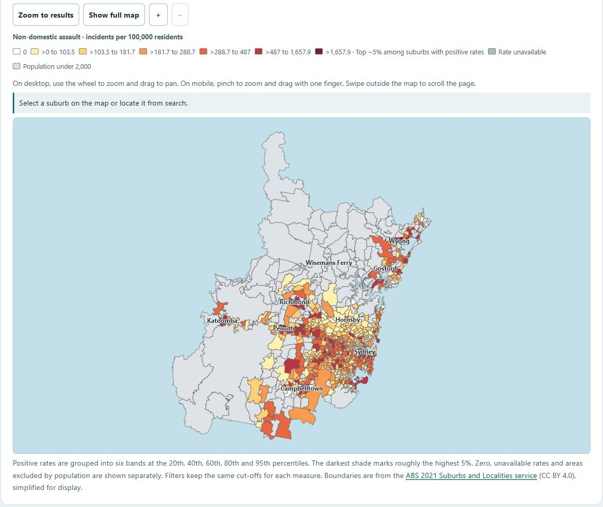

<p align="center">
  
</p>

<h1 align="center">Sydney Crime Map</h1>

<p align="center">
  <strong>Explore the suburbs. Understand the numbers.</strong><br>
  An independent, bilingual view of recorded crime across Greater Sydney and the Central Coast.<br>
  用数据探索悉尼与中央海岸的社区。
</p>

<p align="center">
  <a href="https://sydcrime.xdxo.top/"><strong>打开地图 · Open the map &rarr;</strong></a>
  &nbsp;&nbsp;·&nbsp;&nbsp;
  <a href="#automatic-data-updates">Automatic updates</a>
  &nbsp;&nbsp;·&nbsp;&nbsp;
  <a href="#getting-started">Getting started</a>
  &nbsp;&nbsp;·&nbsp;&nbsp;
  <a href="#data-and-methodology">Methodology</a>
</p>

<p align="center">
  
  
  
  
</p>

<p align="center">
  <a href="https://sydcrime.xdxo.top/">
    
  </a><br>
  <sub>Example map view. The data and colour bands can change as the snapshot is updated.</sub>
</p>

> [!IMPORTANT]
> A recorded crime rate is **not** an individual's probability of experiencing crime. Read the counts, population and context together.

## Explore with context

🗺️ **See the bigger picture.** Switch between a ranked list and an interactive, colour-coded suburb map. Zoom, pan and explore on desktop or mobile.

🔎 **Find the details.** Search for one or more suburbs, filter by region and population, and inspect counts across 62 offence categories.

⚖️ **Compare up to four suburbs.** View their counts, rates and rankings alongside a fixed Greater Sydney and Central Coast benchmark.

🌏 **Choose your language.** Explore the site and suburb pages in English or Chinese.

The map offers four selectable measures: non-domestic assault, residential break-ins, total assault and violent crime. Rates are calculated per 100,000 residents using the 2021 Census population.

## Automatic data updates

[](https://github.com/Revolt3738/sydney-crime-map/actions/workflows/update-crime-data.yml)

The repository includes a GitHub Actions workflow scheduled for **02:17 UTC on the 15th of each month**. When enabled, it checks the official BOCSAR suburb archive for new data and revisions to existing months.

```text
BOCSAR archive  →  Validate source  →  Recalculate  →  Test & build  →  Commit changes
                     and period       rates & ranks                    when needed
```

1. **Download** the official suburb data and select the latest 12 consecutive monthly columns.
2. **Validate** the source, reporting period, offence categories, suburb matches and values. Older reporting periods are rejected.
3. **Recalculate** counts, rates and tied ranks using the existing Census populations and boundaries.
4. **Test and build** the snapshot and bilingual static site. If the data or reporting period changed, commit the updated snapshot and generated pages to `main`; otherwise, create no commit.

Validation or build failures stop the workflow before the commit; a failed push is reported as a failed run.

The workflow can also be started manually from GitHub Actions. A separate Cloudflare scheduler is available as an alternative trigger; use only one scheduler at a time. **Automatic publication requires separately configured and verified Cloudflare Workers Builds.**

See the [automation guide](docs/automation.md) for permissions, scheduling, deployment prerequisites, monitoring and recovery.

## Data and methodology

| | |
| --- | --- |
| **Crime data period** | Latest processed 12-month period; see [`work/crime_period.json`](work/crime_period.json) |
| **Population and boundaries** | Australian Bureau of Statistics (ABS), 2021 Census and geography |
| **Geographic coverage** | Greater Sydney and the Central Coast; 926 suburbs |
| **Offence categories** | 62 recorded offence categories |
| **Rate** | Measure count ÷ 2021 Census population × 100,000 |

Crime figures are derived from data published by the NSW Bureau of Crime Statistics and Research (BOCSAR). Most categories count police-recorded incidents; murder and manslaughter are counted by victim. Population figures and suburb boundaries are based on ABS data. The project is not affiliated with BOCSAR or the ABS.

### Interpreting the statistics

- A small resident population can make a suburb's rate change sharply after only a few incidents.
- The population denominator is from 2021; growth and other changes since the Census can affect comparisons.
- Incidents may involve visitors, workers and other non-residents who are not counted in the resident population.
- Rankings describe recorded incident rates across the covered suburbs. They are not a complete measure of safety or an assessment of individual risk.

### Official sources

- [BOCSAR Crime Mapping Tool](https://crimetool.bocsar.nsw.gov.au/bocsar)
- [BOCSAR criminal incident data](https://bocsar.nsw.gov.au/statistics-dashboards/open-datasets/criminal-offences-data.html)
- [ABS Census data](https://www.abs.gov.au/census/find-census-data)
- [ABS 2021 geographic boundary files](https://www.abs.gov.au/statistics/standards/australian-statistical-geography-standard-asgs/edition-3-july-2021-june-2026/access-and-downloads/digital-boundary-files)

Please follow the source agencies' attribution and reuse terms when using or redistributing their data.

## Getting started

The site uses HTML, CSS and vanilla JavaScript. The build and validation scripts use Node.js and Python standard libraries, so no npm install is needed for local development. The project was checked with Node.js 26 and Python 3. Deployment and scheduler tooling have separate pinned dependencies.

```bash
git clone https://github.com/Revolt3738/sydney-crime-map.git
cd sydney-crime-map

# Run the tests, build the site and validate the bilingual pages
python work/check_site.py

# Serve the generated site locally
python -m http.server 8000 --bind 127.0.0.1 --directory outputs/sydney-crime-seo
```

Open [http://127.0.0.1:8000/](http://127.0.0.1:8000/) in a browser.

To check the official BOCSAR archive without changing the snapshot:

```bash
python work/update_crime_data.py --dry-run
```

This check downloads the official archive. The [automation guide](docs/automation.md#local-verification) also explains how to use an existing local archive.

## Project structure

```text
.github/workflows/          Scheduled and manual update workflow
docs/automation.md          Setup, deployment and monitoring guide
scheduler/                  Optional Cloudflare workflow trigger
work/
  automation/               Source validation and statistics processing
  crime_data.json           Processed crime and population snapshot
  crime_period.json         Reporting period of the current snapshot
  suburb_shapes.json        Processed suburb boundaries
  suburb_view.html          Interactive page template
  suburb_*.js, *.css        Interface, map and language modules
  update_crime_data.py      Download and process BOCSAR suburb data
  check_site.py             Tests, site builds and validation
  build_suburb_view.mjs     Interactive page builder
  build-seo.mjs             Bilingual pages and sitemap builder
tests/                      Automation and build checks
outputs/sydney-crime-seo/   Ready-to-publish static site
```

## Deployment

Publish the contents of `outputs/sydney-crime-seo/` as static assets. The [automation guide](docs/automation.md) describes the Cloudflare scheduler, Workers Builds prerequisites and deployment verification.
